<div align="center">

# INSTITUTO POLITÉCNICO NACIONAL
### ESCUELA SUPERIOR DE CÓMPUTO

<br/>

## **Desarrollo de Aplicaciones Móviles Nativas**
### **Práctica 4: Gestión de archivos multiplataforma (Android e iOS)**

---

**Profesor:** M. en C. Gabriel Hurtado Avilés  
**Grupo:** 7CV4 &nbsp;|&nbsp; **Ciclo Escolar:** 2027-1  

---

### **Integrantes del Equipo**

| Nombre Completo | Boleta |
| :--- | :---: |
| **Hernández Alvirde María Guadalupe** | 2022630105 |
| **Aragón Martínez Manuel Alejandro** | 2023630411 |

<br/>

**Ciudad de México, noviembre de 2026**

---

</div>

## 📑 Contenido

1. [Introducción](#1-introducción)
2. [Tecnología, versiones y dependencias](#2-tecnología-versiones-y-dependencias)
3. [Compilación y ejecución](#3-compilación-y-ejecución)
4. [Desarrollo](#4-desarrollo)
5. [Implementación](#5-implementación)
6. [Capturas de pantalla](#6-capturas-de-pantalla)
7. [Pruebas realizadas](#7-pruebas-realizadas)
8. [Matriz de pruebas](#8-matriz-de-pruebas)
9. [Conclusiones](#9-conclusiones)
10. [Bibliografía](#10-bibliografía)

---

## 1. Introducción

El objetivo de esta práctica es desarrollar **dos aplicaciones móviles multiplataforma para Android e iOS** que implementen almacenamiento local, lectura, escritura, persistencia y visualización de archivos en distintos formatos, respetando las restricciones de seguridad de cada sistema operativo. Ambas aplicaciones funcionan **completamente sin conexión a Internet**.

| Parte | Aplicación | Carpeta |
|---|---|---|
| **1** | **Gestor de Archivos**: explorador que trabaja sólo con ubicaciones a las que la app tiene acceso legítimo (su almacenamiento privado y las carpetas o archivos que el usuario elige con el selector del sistema). Visualiza TXT, Markdown, JSON y XML con resaltado de sintaxis e imágenes con zoom y rotación; muestra metadatos y permite copiar, mover, renombrar y eliminar. | [`gestor_archivos/`](gestor_archivos) |
| **2** | **Ruta del Ajolote**: juego original en el que un ajolote recorre los canales de Xochimilco recolectando burbujas de oxígeno. Tiene dos modos, puntuación, estrellas y progreso, y guarda, carga, visualiza y exporta partidas en **texto plano, XML y JSON**. | [`ruta_ajolote/`](ruta_ajolote) |

---

## 2. Tecnología, versiones y dependencias

Se eligió **Flutter (Dart)** para ambas partes. Permite compartir la interfaz y la lógica entre Android e iOS, y deja escribir código nativo (Kotlin y Swift) mediante canales de plataforma (`MethodChannel`) exactamente donde cada sistema exige una API propia: el acceso a documentos fuera del sandbox.

| Componente | Versión / valor |
|---|---|
| Flutter (canal stable) | 3.50.0 |
| Dart | 3.14.0 |
| Android: `compileSdk` / `targetSdk` | 36 (valores de Flutter 3.50) |
| Android: `minSdk` | **24 (Android 7.0)**, requisito de la práctica |
| Android NDK | 30.0.16248370 |
| iOS: Deployment Target | **15.0**, requisito de la práctica |
| Lenguaje nativo Android / iOS | Kotlin / Swift |
| Equipo de desarrollo | Windows 11 Pro, Intel Core i5-8350U, 16 GB RAM |
| Dispositivo de prueba Android | Emulador "Medium Phone", Android API 37, x86_64 |
| Dispositivo de prueba iOS | *Pendiente* (simulador o iPhone en macOS con Xcode) |

### Dependencias

| Paquete | Versión | Uso | App |
|---|---|---|---|
| `provider` | 6.1.5+1 | Estado global | Ambas |
| `shared_preferences` | 2.5.6 | Preferencias, recientes, favoritos y progreso (SharedPreferences / NSUserDefaults) | Ambas |
| `path_provider` (+ `path_provider_android`) | 2.1.6 (2.2.17) | Directorios privados y caché | Ambas |
| `share_plus` | 13.3.1 | Compartir con el menú del sistema | Ambas |
| `xml` | 7.1.0 | Validar, formatear, generar y leer XML | Ambas |
| `mime` / `path` | 2.1.0 / 1.9.1 | Tipo MIME por extensión y rutas | Gestor |
| `audioplayers` | 6.8.1 | Efectos de sonido | Juego |

El resaltado de sintaxis, la caché de miniaturas, el acceso SAF / Document Picker, los efectos de sonido (sintetizados como WAV en el dispositivo) y los tres serializadores de partidas se implementaron dentro de los proyectos, sin librerías adicionales.

---

## 3. Compilación y ejecución

### 3.1 Android (Windows, macOS o Linux)

1. Instalar **Flutter 3.50** y **Android Studio**; desde *SDK Manager → SDK Tools* instalar *Android SDK Command-line Tools* y *NDK (Side by side)*.
2. Crear un emulador en *Device Manager* (o conectar un teléfono con depuración USB). En Windows sin Hyper-V se necesita el *Android Emulator hypervisor driver*.
3. Verificar el entorno con `flutter doctor`.
4. Compilar y ejecutar cada app:

```bash
cd Practica4/gestor_archivos      # o Practica4/ruta_ajolote
flutter pub get
flutter test                      # pruebas unitarias
flutter run                       # con el emulador abierto
```

APK de depuración: `flutter build apk --debug` → `build/app/outputs/flutter-apk/app-debug.apk`.

> Si tu NDK instalado no es `30.0.16248370`, cambia `ndkVersion` en `android/app/build.gradle.kts` por la versión que tengas en `Android/sdk/ndk/`.

### 3.2 iOS (requiere macOS con Xcode)

1. Instalar **Xcode** desde la App Store y abrirlo una vez para aceptar la licencia e instalar los componentes adicionales.
2. Configurar las herramientas de línea de comandos:
   ```bash
   sudo xcode-select --switch /Applications/Xcode.app/Contents/Developer
   sudo xcodebuild -runFirstLaunch
   ```
3. Instalar CocoaPods: `brew install cocoapods` (o `sudo gem install cocoapods`).
4. Abrir un simulador con iOS 15 o superior: `open -a Simulator`.
5. Compilar y ejecutar:
   ```bash
   cd Practica4/gestor_archivos      # o Practica4/ruta_ajolote
   flutter pub get
   cd ios && pod install && cd ..
   flutter run
   ```
6. Para un iPhone físico: abrir `ios/Runner.xcworkspace` en Xcode → *Signing & Capabilities* → elegir el *Team* (un Apple ID gratuito funciona) y, si es necesario, cambiar el *Bundle Identifier*.

---

## 4. Desarrollo

### 4.1 Parte 1: Gestor de archivos multiplataforma

La pantalla principal tiene cuatro secciones: **Explorar**, **Recientes**, **Favoritos** y **Ajustes**. En teléfonos en vertical se navega con una barra inferior y en pantallas anchas u horizontales con un riel lateral; cada pestaña conserva su propia pila de navegación.

- **Ubicaciones autorizadas:** almacenamiento propio de la app más carpetas o archivos elegidos con el selector del sistema. Antes de abrir el selector se explica para qué se pide el acceso; si el usuario cancela, se informa y no se concede nada.
- **Navegación** con breadcrumbs tocables, vista de lista o cuadrícula, filtro por nombre y botón "atrás" que sube de carpeta sin salir de la raíz autorizada.
- **Visores:** TXT y Markdown (con edición y guardado); JSON y XML formateados con resaltado de sintaxis, números de línea y aviso si el documento no es válido; imágenes con zoom (pellizco, doble toque y botones) y rotación de 90°.
- **Formatos no soportados:** diálogo con *Abrir con…*, *Compartir*, *Exportar* y *Ver como texto*.
- **Metadatos:** nombre, tipo MIME (y UTType en iOS), tamaño, fecha de creación y de modificación, origen y permisos; lo que no existe se muestra como "No disponible".
- **Operaciones:** crear carpeta o archivo de texto, copiar, mover, renombrar y eliminar (con confirmación), incluso entre el almacenamiento propio y una carpeta SAF.
- **Persistencia:** recientes, favoritos, ubicaciones autorizadas y tema se conservan al cerrar la app.
- **Caché de miniaturas** en dos niveles: memoria (LRU de 120 elementos) y disco (carpeta de caché del sistema).
- **Temas** Guinda (IPN) y Azul (ESCOM), cada uno en claro y oscuro, siguiendo automáticamente el modo del sistema.

| | | |
|:---:|:---:|:---:|
| 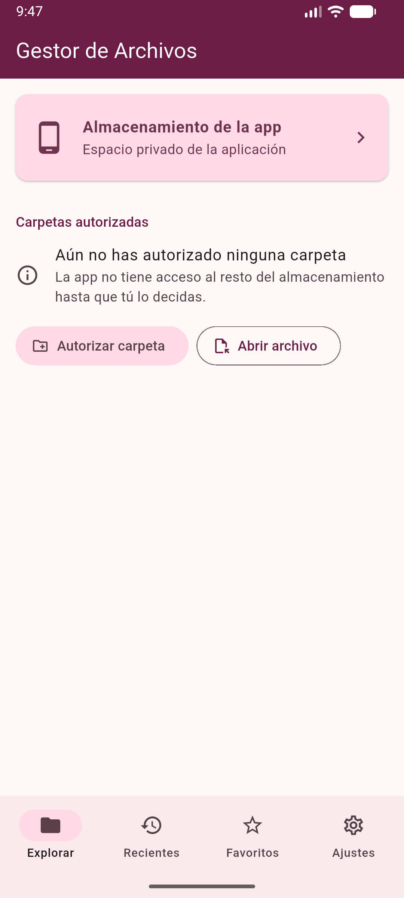 | 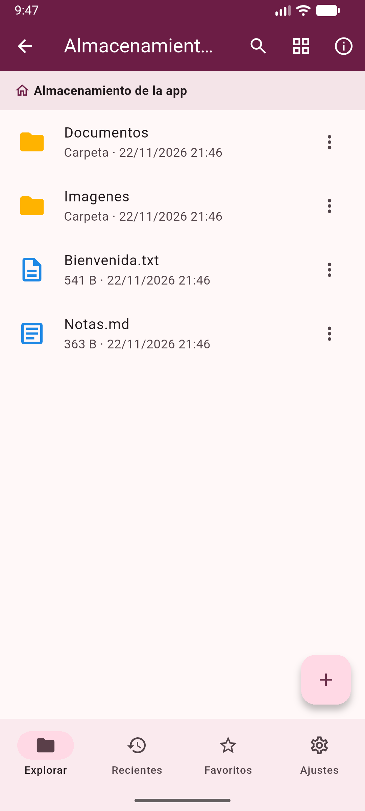 | 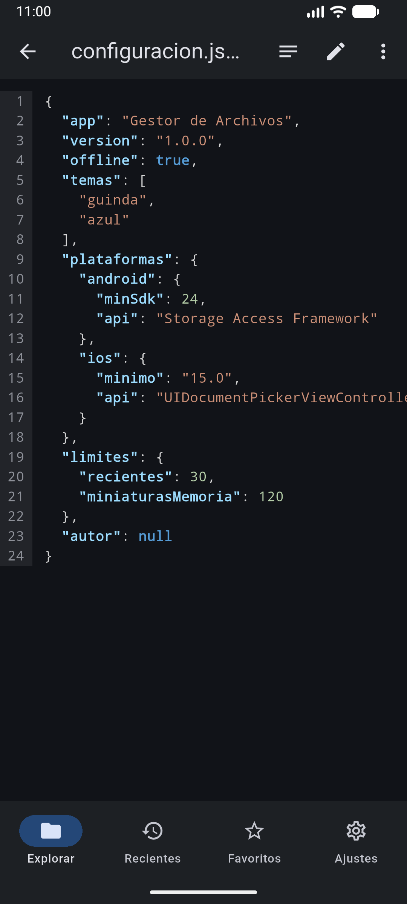 |
| *Fig. 1. Explorar (tema Guinda)* | *Fig. 2. Almacenamiento propio con breadcrumbs* | *Fig. 3. JSON con resaltado y números de línea* |
| 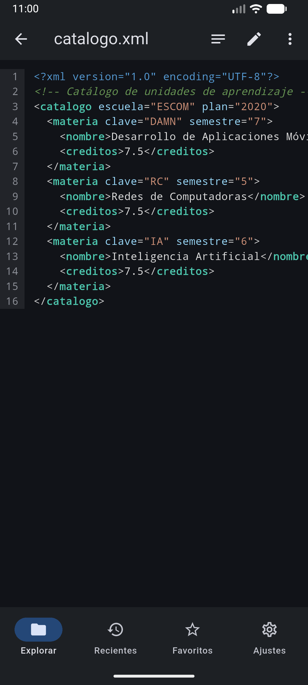 | 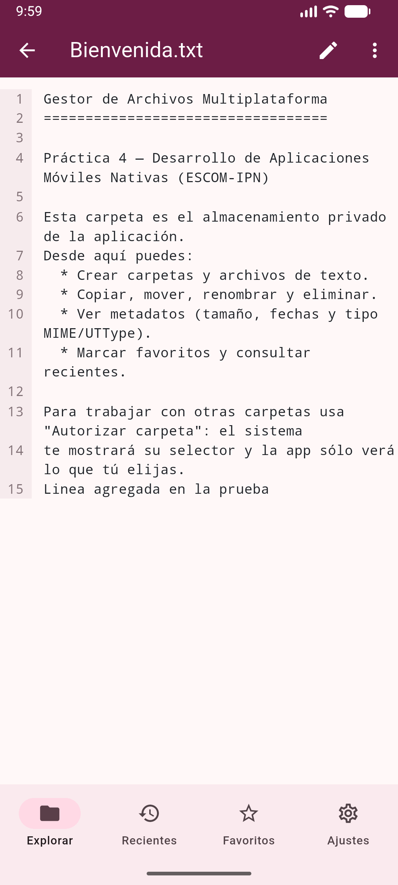 | 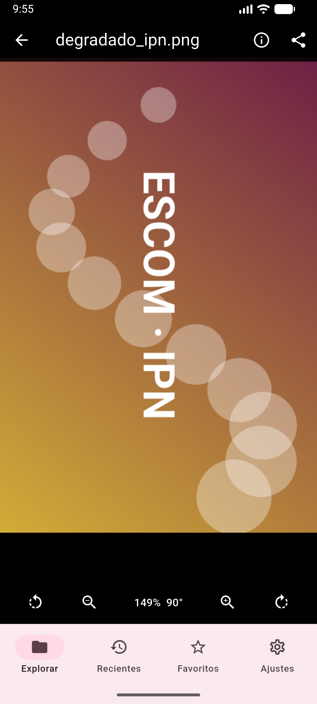 |
| *Fig. 4. XML con resaltado (modo oscuro)* | *Fig. 5. TXT editado y guardado (línea 15)* | *Fig. 6. Imagen con zoom 149 % y giro 90°* |
| 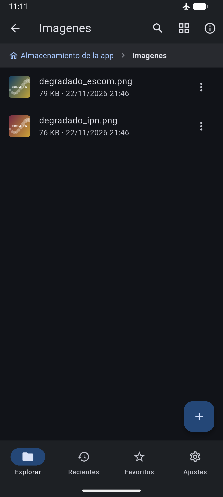 | 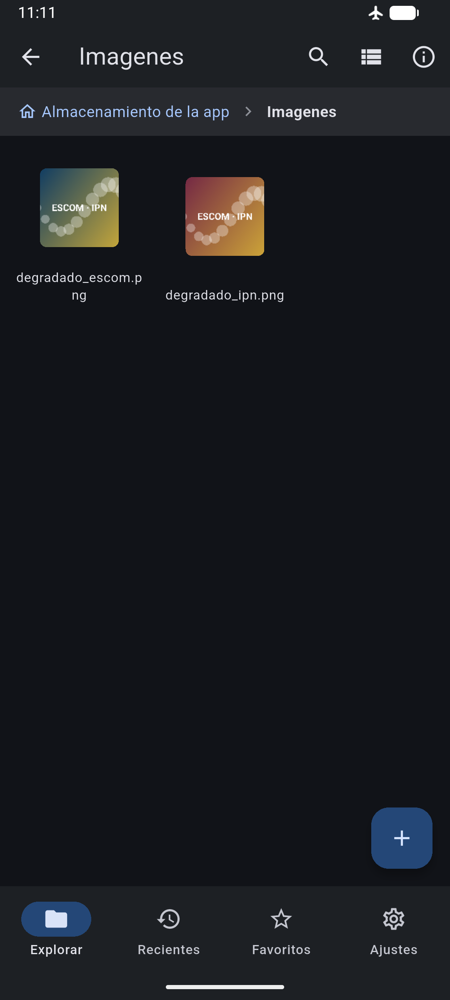 | 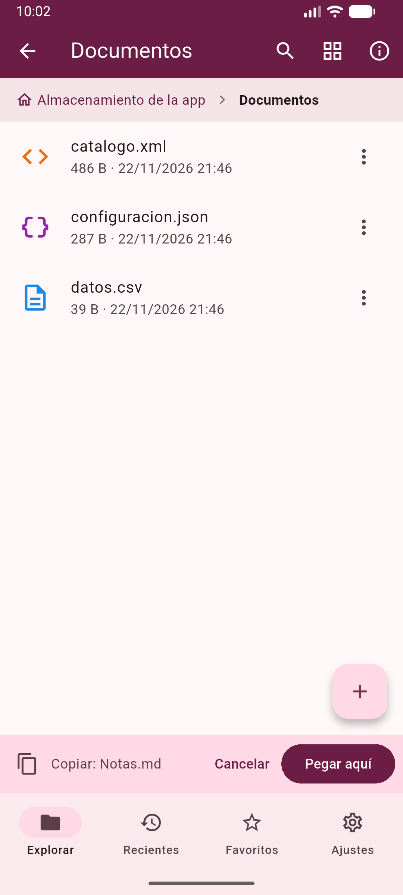 |
| *Fig. 7. Miniaturas desde la caché* | *Fig. 8. Vista de cuadrícula* | *Fig. 9. Copiar: barra "Pegar aquí"* |
| 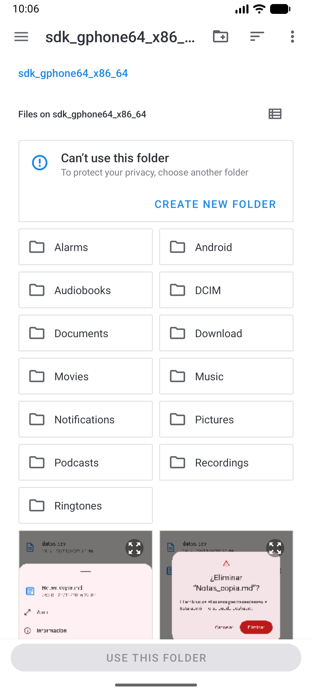 | 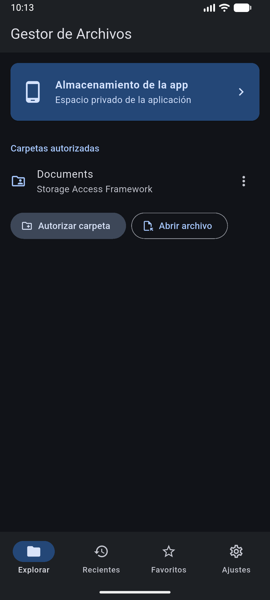 | 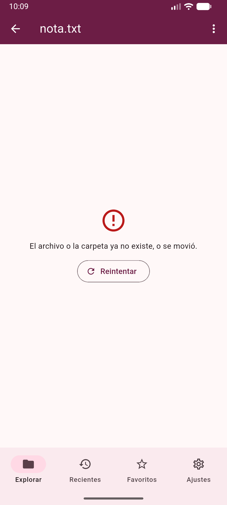 |
| *Fig. 10. Selector SAF: la raíz no se puede elegir* | *Fig. 11. Carpeta autorizada vía SAF* | *Fig. 12. Archivo borrado por fuera: error legible* |

### 4.2 Parte 2: Ruta del Ajolote

Juego original de rompecabezas por casillas. El ajolote se mueve deslizando el dedo sobre el tablero, con la cruceta en pantalla o con las flechas del teclado. El tablero, el agua, los elementos y el propio ajolote se dibujan con un `CustomPainter`, sin imágenes externas.

| Elemento | Regla |
|---|---|
| 🫧 Burbuja | +10 puntos al recogerla. |
| 🪨 Piedra | Bloquea el paso; el intento no cuenta como movimiento. |
| 🌀 Remolino | Quita una vida y regresa al ajolote a su casilla de inicio. |
| ➤ Corriente | Empuja al ajolote una casilla extra en su dirección. |
| 🚪 Compuerta | Meta del modo Aventura; sólo se abre cuando no quedan burbujas. |

- **Modo Aventura:** 5 niveles diseñados a mano con límite de movimientos. Al ganar se suman 5 puntos por movimiento sobrante y 20 por vida; se otorgan de 1 a 3 estrellas y se desbloquea el siguiente nivel.
- **Modo Contrarreloj:** mapas aleatorios reproducibles a partir de una semilla; cada mapa despejado suma 50 puntos y 10 segundos. Se guarda el récord.
- **Efectos:** ondas de agua, remolinos que giran, corrientes animadas, compuerta que brilla al abrirse, partículas al reventar burbujas, destello rojo y sacudida al recibir daño, y sonidos y vibración por evento.
- **Menú de opciones:** formato de guardado (TXT, XML o JSON), acceso a la gestión de partidas, tema y modo de color, color del ajolote, cuadrícula, sonido, vibración, dificultad (vidas) y tiempo del contrarreloj.
- **Gestión de partidas:** guardar con nombre, etiquetas y formato; lista con metadatos y filtros por formato y etiqueta; ver el contenido del archivo con resaltado; ver el historial de movimientos; copiar a otro formato; exportar a una carpeta elegida; compartir; importar y eliminar.
- **Persistencia robusta:** autoguardado tras cada movimiento y al pasar a segundo plano; al reabrir la app aparece "Continuar".

| | | |
|:---:|:---:|:---:|
| 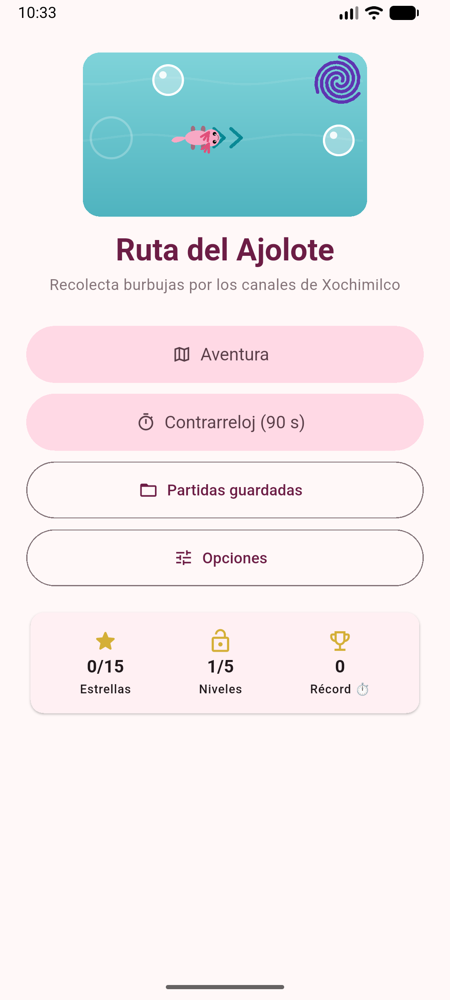 | 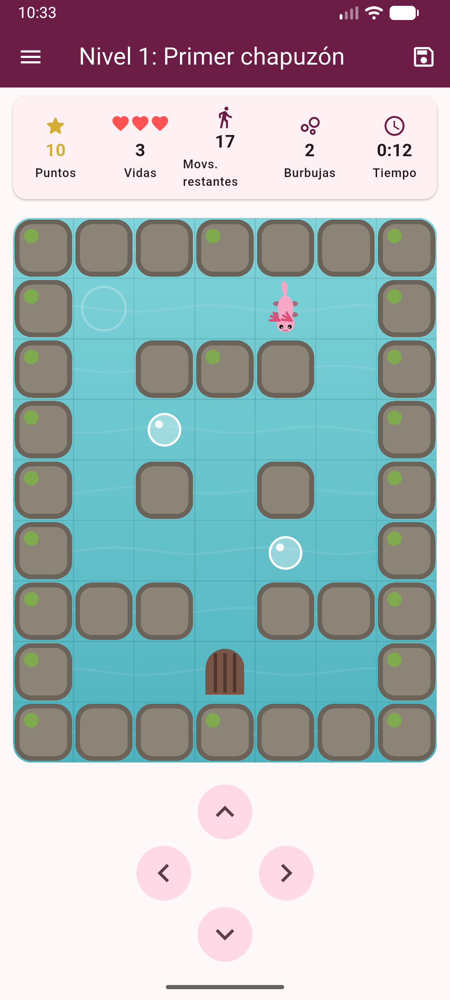 | 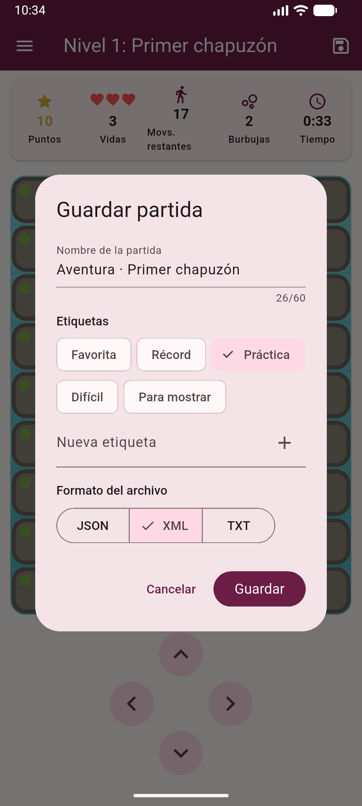 |
| *Fig. 13. Pantalla de inicio* | *Fig. 14. Nivel 1 en juego* | *Fig. 15. Guardar: etiquetas y formato* |
|  | 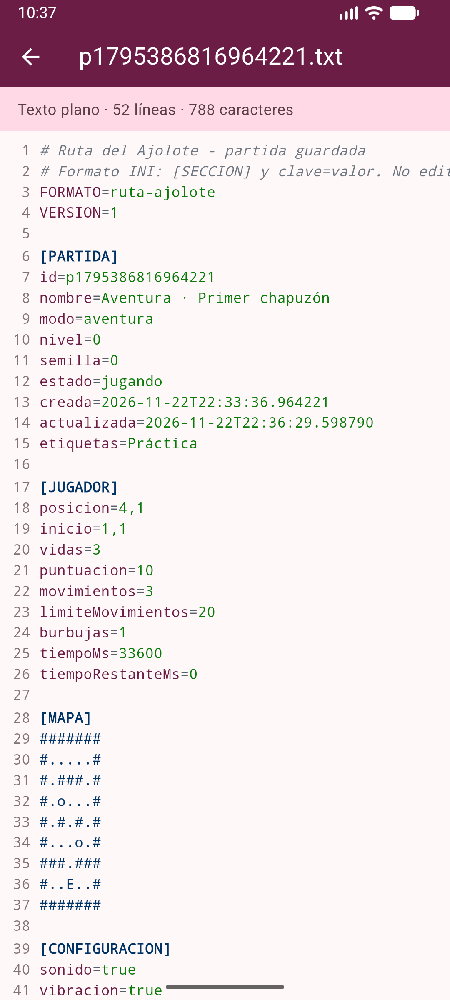 | 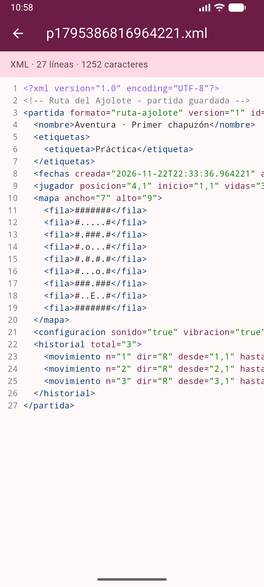 |
| *Fig. 16. Dos archivos dañados no afectan a la partida válida* | *Fig. 17. Contenido del archivo TXT* | *Fig. 18. Contenido del archivo XML* |
| 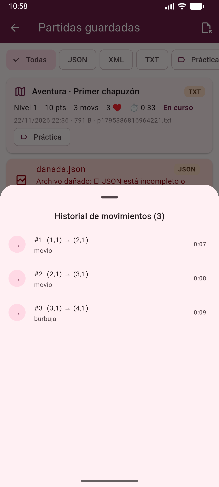 | 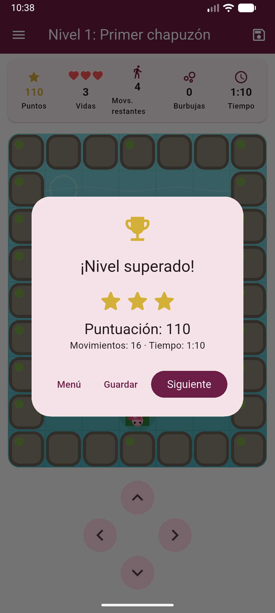 | 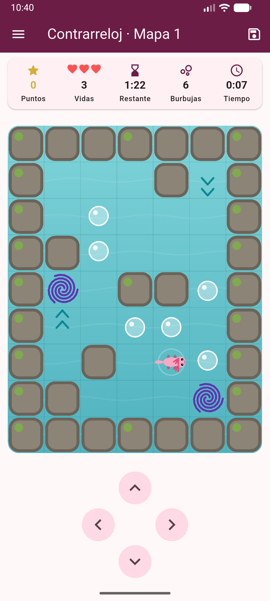 |
| *Fig. 19. Historial de movimientos* | *Fig. 20. Nivel superado con 3 estrellas* | *Fig. 21. Contrarreloj: mapa aleatorio* |
| 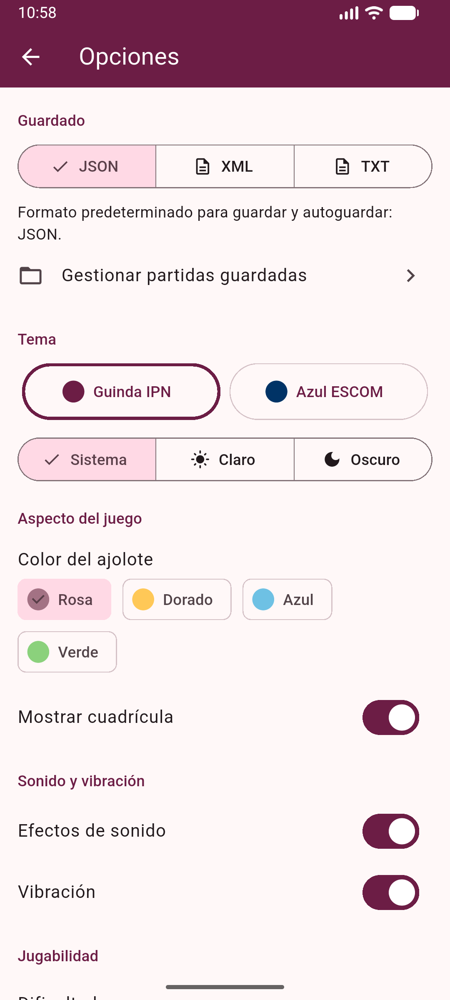 | 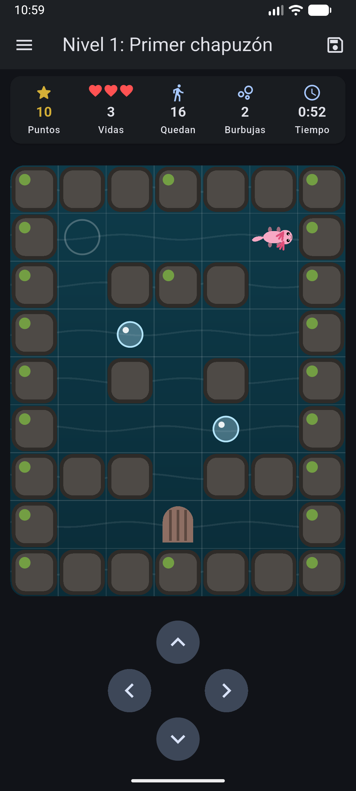 | |
| *Fig. 22. Menú de opciones* | *Fig. 23. Tema Azul en modo oscuro* | |

---

## 5. Implementación

### 5.1 Estructura del proyecto

```
Practica4/
├── gestor_archivos/                 Parte 1
│   ├── lib/core/                    temas, errores legibles, formato
│   ├── lib/data/                    native_storage (canal) · storage_service
│   │                                thumbnail_cache · app_state · sample_files
│   ├── lib/ui/                      explorar, explorador, visores, ajustes
│   ├── test/                        pruebas unitarias
│   ├── android/.../MainActivity.kt  Storage Access Framework
│   └── ios/Runner/AppDelegate.swift StoragePlugin (Document Picker + bookmarks)
├── ruta_ajolote/                    Parte 2
│   ├── lib/game/                    model · engine (reglas puras) · levels
│   ├── lib/save/                    codec (TXT/XML/JSON) · repository · native_files
│   ├── lib/ui/                      inicio, juego, tablero, partidas, visor, opciones
│   ├── test/                        engine_test · codec_test
│   ├── android/.../MainActivity.kt  exportar / importar con SAF
│   └── ios/Runner/AppDelegate.swift ArchivosPlugin (UIDocumentPicker)
└── docs/capturas/                   evidencias usadas en este README
```

### 5.2 Arquitectura compartida

Ambas apps separan la **interfaz** (widgets de Flutter) de una **capa de datos** en Dart que oculta si un archivo vive en el sistema de archivos local o detrás de un proveedor de documentos. La lógica del juego (`engine.dart`) es Dart puro, sin dependencias de Flutter, por lo que se prueba con pruebas unitarias. Todas las excepciones de plataforma se convierten a un tipo propio (`FsException` / `SaveFormatException`) con un mensaje legible en español, para que ningún error bloquee la aplicación.

- **Gestor:** `StorageService` decide por la referencia: las rutas normales usan `dart:io` (almacenamiento propio y carpetas de iOS ya abiertas) y las URIs `content://` se delegan al canal nativo `mx.ipn.escom/storage`.
- **Juego:** `SaveRepository` guarda en la carpeta privada `Application Support/partidas` con **escritura atómica** (archivo temporal + renombrar); `SaveCodec` serializa; `NativeFiles` usa el canal `mx.ipn.escom/archivos` sólo para exportar e importar.

### 5.3 Código específico de Android

En `MainActivity.kt` se implementa el **Storage Access Framework**. La app **no declara ningún permiso de almacenamiento** (ni `READ/WRITE_EXTERNAL_STORAGE` ni `MANAGE_EXTERNAL_STORAGE`): respeta Scoped Storage.

- `ACTION_OPEN_DOCUMENT_TREE` / `ACTION_OPEN_DOCUMENT` para elegir carpetas o archivos, `takePersistableUriPermission` para conservar el acceso y `getPersistedUriPermissions` para detectar permisos revocados.
- Listado con `DocumentsContract.buildChildDocumentsUriUsingTree` y una sola consulta por carpeta (nombre, MIME, tamaño, fecha y banderas).
- Crear, renombrar y eliminar con `createDocument`, `renameDocument` y `deleteDocument`, respetando las banderas `FLAG_SUPPORTS_WRITE / DELETE / RENAME` y `FLAG_DIR_SUPPORTS_CREATE` del proveedor.
- `ACTION_CREATE_DOCUMENT` para exportar y `FileProvider` para "Abrir con" sobre archivos privados. La fecha de creación se obtiene con `java.nio` (API 26+); en API 24-25 se muestra "No disponible".

```kotlin
"pickDirectory" -> startPicker(result, reqPickDir) {
    Intent(Intent.ACTION_OPEN_DOCUMENT_TREE).apply { addFlags(persistFlags()) }
}
// ...
reqPickDir -> background(result) {
    val tree = data.data!!
    takePersist(tree, data.flags)   // acceso persistente sólo a esta carpeta
    val rootDoc = DocumentsContract.buildDocumentUriUsingTree(
        tree, DocumentsContract.getTreeDocumentId(tree))
    stat(rootDoc) + mapOf("treeUri" to tree.toString())
}
```

### 5.4 Código específico de iOS

En `AppDelegate.swift` se registra un plugin propio. La app vive dentro de su **sandbox** y para cualquier otra ubicación usa `UIDocumentPickerViewController`.

- Carpetas (`forOpeningContentTypes: [.folder]`) y archivos (`[.item]`) como recursos **security-scoped**, abiertos con `startAccessingSecurityScopedResource()`.
- Se guarda un **bookmark** (base64) de cada ubicación para recuperar el acceso al reabrir la app; si ya no se resuelve, la ubicación se marca como "No disponible".
- Metadatos con `FileManager.attributesOfItem` (fecha de creación) y `UTType` (identificador y MIME).
- `UIDocumentInteractionController` para "Abrir con" y `UIDocumentPickerViewController(forExporting:asCopy:)` para exportar.
- `UIFileSharingEnabled` y `LSSupportsOpeningDocumentsInPlace` hacen visible la carpeta Documentos de la app en la app Archivos.

```swift
case "pickDirectory":
  present(UIDocumentPickerViewController(forOpeningContentTypes: [.folder]), mode: "dir", result: result)
// ...
guard url.startAccessingSecurityScopedResource() else { continue }
if let data = try? url.bookmarkData(options: [], includingResourceValuesForKeys: nil, relativeTo: nil) {
  item["bookmark"] = data.base64EncodedString()   // para recuperar el acceso después
}
```

### 5.5 APIs de acceso a archivos por operación

| Operación | Android | iOS |
|---|---|---|
| Espacio propio | `getApplicationSupportDirectory` (filesDir) | Documents / Application Support (sandbox) |
| Elegir carpeta | `ACTION_OPEN_DOCUMENT_TREE` | `UIDocumentPicker [.folder]` |
| Conservar acceso | `takePersistableUriPermission` | `bookmarkData` (security-scoped) |
| Listar / leer / escribir | `DocumentsContract` + `ContentResolver` | `FileManager` / `dart:io` tras `startAccessing…` |
| Exportar | `ACTION_CREATE_DOCUMENT` | `UIDocumentPicker forExporting` |
| Abrir con otra app | `ACTION_VIEW` + `FileProvider` | `UIDocumentInteractionController` |
| Compartir | `share_plus` (`Intent.ACTION_SEND`) | `share_plus` (`UIActivityViewController`) |

### 5.6 Serialización TXT, XML y JSON

Las partidas se guardan en el formato que elige el usuario. Cada archivo contiene **estado del juego** (mapa, posición, inicio, modo, nivel y estado), **puntuación**, **tiempo** transcurrido y restante, **configuraciones personalizadas** e **historial de movimientos**. Los tres formatos se convierten a una estructura intermedia común y pasan por la **misma validación** (`lib/save/codec.dart`).

<details>
<summary><b>JSON (extracto)</b></summary>

```json
{ "formato": "ruta-ajolote", "version": 1,
  "partida": { "id": "p1795…", "nombre": "Aventura · Primer chapuzón", "modo": "aventura",
               "nivel": "0", "estado": "jugando", "etiquetas": ["Práctica"] },
  "jugador": { "posicion": "4,1", "vidas": 3, "puntuacion": 10, "movimientos": 3, "tiempoMs": 33600 },
  "mapa": ["#######", "#.....#", "…"],
  "configuracion": { "sonido": true, "colorAjolote": "rosa", "dificultad": "normal" },
  "historial": [ { "n": 1, "dir": "R", "desde": "1,1", "hasta": "2,1", "evento": "movio", "ms": 7100 } ] }
```
</details>

<details>
<summary><b>XML (extracto)</b></summary>

```xml
<partida formato="ruta-ajolote" version="1" id="p1795…" modo="aventura" nivel="0" estado="jugando">
  <nombre>Aventura · Primer chapuzón</nombre>
  <etiquetas><etiqueta>Práctica</etiqueta></etiquetas>
  <jugador posicion="4,1" inicio="1,1" vidas="3" puntuacion="10" movimientos="3" tiempoMs="33600"/>
  <mapa ancho="7" alto="9"><fila>#######</fila> …</mapa>
  <configuracion sonido="true" colorAjolote="rosa" dificultad="normal"/>
  <historial total="3"><movimiento n="1" dir="R" desde="1,1" hasta="2,1" evento="movio" ms="7100"/> …</historial>
</partida>
```
</details>

<details>
<summary><b>Texto plano (extracto, formato INI)</b></summary>

```ini
FORMATO=ruta-ajolote
VERSION=1
[PARTIDA]
nombre=Aventura · Primer chapuzón
etiquetas=Práctica
[JUGADOR]
posicion=4,1
vidas=3
[MAPA]
#######
#.....#
[HISTORIAL]
# n;dir;desde;hasta;evento;ms
1;R;1,1;2,1;movio;7100
[FIN]
```
</details>

**Validación de archivos:**

- **Vacío:** "El archivo está vacío."
- **Incompleto:** JSON o XML mal formado (con la posición del error), o TXT sin la marca final `[FIN]`.
- **Ajeno:** "No es una partida de Ruta del Ajolote." (se revisan el campo `formato` y la versión).
- **Datos inválidos:** filas del mapa con distinto ancho, símbolos desconocidos, posición fuera del mapa o sobre una piedra, números negativos o un movimiento del historial dañado.
- Cada archivo se lee por separado: uno dañado aparece en rojo con su error y **no impide cargar los demás**. Al importar, el archivo se valida completo antes de copiarlo.

### 5.7 Persistencia y permisos

- **Preferencias** (tema, formato, opciones, progreso, recientes, favoritos y ubicaciones) en SharedPreferences / NSUserDefaults como JSON; si una lista está dañada, sólo esa lista se reinicia.
- **Escritura atómica:** se escribe a un archivo temporal y luego se renombra, para no dejar archivos a medio escribir si la app se cierra.
- **Antes de escribir** se valida que el destino admita creación, que el nombre sea válido y no exista, y que haya espacio libre suficiente.
- **Acciones destructivas** (eliminar, descartar ediciones, reiniciar nivel) siempre piden confirmación.
- Al volver a la app se revisa si algún permiso se revocó desde los ajustes del sistema.

---

## 6. Capturas de pantalla

### 6.1 Android: temas y funcionamiento sin conexión

Además de las capturas de la sección 4 (tema Guinda claro), se muestran el tema Azul en modo oscuro y ambas apps funcionando con el **modo avión activado** (ícono ✈ en la barra de estado).

| | | |
|:---:|:---:|:---:|
| 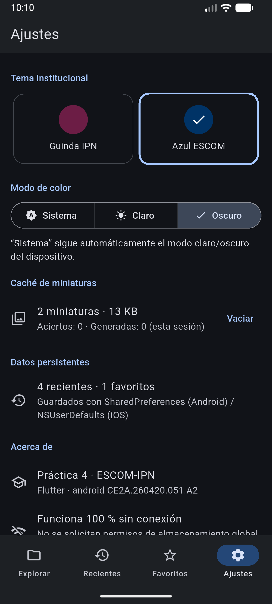 | 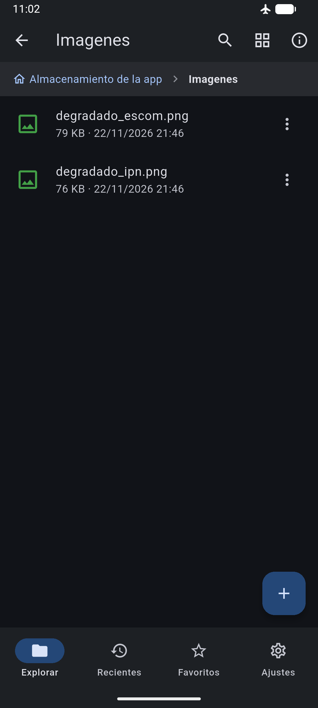 | 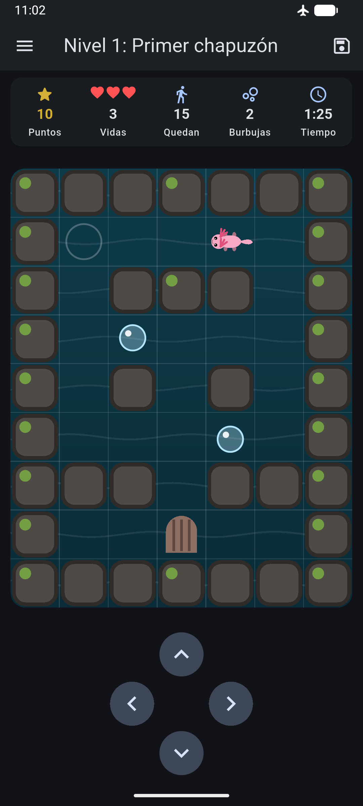 |
| *Fig. 24. Gestor: Azul ESCOM, modo oscuro* | *Fig. 25. Gestor en modo avión* | *Fig. 26. Juego en modo avión (guardado en JSON)* |

### 6.2 iOS

> ⏳ **Pendiente.** La compilación para iOS requiere macOS con Xcode. El código Swift de ambas apps y la configuración (iOS 15 e `Info.plist`) ya están en el repositorio. Las capturas se agregarán en esta sección al ejecutar las apps en el simulador o en un iPhone.

| Captura pendiente | Descripción |
|---|---|
| Fig. 27 | Gestor en iOS: Explorar |
| Fig. 28 | Gestor: carpeta elegida con Document Picker |
| Fig. 29 | Gestor: visor JSON/XML |
| Fig. 30 | Juego en iOS: nivel en curso |
| Fig. 31 | Juego: partidas guardadas |
| Fig. 32 | Juego: exportar a Archivos |

---

## 7. Pruebas realizadas

### 7.1 Entorno de pruebas

| Sistema | Versión | Dispositivo | Estado |
|---|---|---|---|
| Android | API 37 (build CE2A.260420.051.A2) | Emulador Medium Phone, x86_64, 1080×2400 | ✅ Probado |
| iOS | Por registrar (15.0 o superior) | Simulador o iPhone en macOS con Xcode | ⏳ Pendiente |

### 7.2 Pruebas automatizadas

Se ejecutan con `flutter test` y no dependen del sistema operativo.

| Proyecto | Pruebas | Qué verifican | Resultado |
|---|:---:|---|---|
| Gestor de archivos | 4 | Formato de tamaños, validación de nombres, visor por extensión, formateo y detección de JSON/XML inválido | ✅ 4/4 |
| Ruta del Ajolote: motor | 10 | Que cada uno de los 5 niveles tiene solución dentro de su límite (búsqueda en anchura sobre el motor real); piedras, remolinos, corrientes, compuerta cerrada y contrarreloj | ✅ 10/10 |
| Ruta del Ajolote: formatos | 13 | Guardar y cargar conserva todo el estado en TXT, XML y JSON; archivos vacíos, cortados, con mapa dañado, posición inválida o ajenos dan error legible; detección de formato | ✅ 13/13 |

| Nivel | Mínimo de movimientos (BFS) | Límite del nivel |
|---|:---:|:---:|
| 1. Primer chapuzón | 16 | 20 |
| 2. Remolinos de Xochimilco | 20 | 26 |
| 3. Corrientes traviesas | 18 | 24 |
| 4. Laberinto de chinampas | 22 | 28 |
| 5. El gran canal | 28 | 36 |

### 7.3 Pruebas funcionales en Android

- **Sin conexión:** con el modo avión activado, el gestor navegó y mostró archivos, y el juego cargó el autoguardado, se jugó y se guardó en JSON (Fig. 25 y 26).
- **Lectura y escritura:** se editó `Bienvenida.txt` y se verificó con `adb` que la línea agregada quedó escrita; se crearon una carpeta y un archivo dentro de una carpeta SAF y se comprobó que existían en `/sdcard/Documents`.
- **Operaciones no autorizadas:** el selector de Android impidió autorizar la raíz del almacenamiento; un archivo borrado por fuera de la app mostró "El archivo o la carpeta ya no existe" sin cerrarse; el juego rechazó archivos vacíos y corruptos con mensajes claros.
- **Guardado y carga:** una partida se guardó en XML, se copió a TXT y se cargó desde el TXT, continuando con la misma puntuación, movimientos y tiempo; al terminarla se obtuvieron 110 puntos y 3 estrellas, lo que coincide con la fórmula de puntuación.
- **Recuperación:** recientes, favoritos, tema y carpeta autorizada sobrevivieron a cerrar y reinstalar el gestor; la partida en curso del juego se ofreció en "Continuar" al reabrir.

### 7.4 Errores encontrados y corregidos durante las pruebas

| Error | Causa | Corrección |
|---|---|---|
| La app cerraba al iniciar en Android | Versión retirada de la librería `jni` (1.2.0) usada por `path_provider` y `shared_preferences` | Actualizar `jni` a 1.2.1 y fijar `path_provider_android` 2.2.17 |
| Números de línea desfasados en el visor | La columna de números no consideraba las líneas ajustadas | Número junto a cada línea con `ListView` (además rinde mejor con archivos grandes) |
| "Pegar aquí" tapado por el botón + | La barra estaba dentro del contenido | Moverla a la ranura inferior del `Scaffold` |
| Íconos de la barra de estado ilegibles en modo oscuro | Estilo de la barra del sistema no definido | `SystemUiOverlayStyle.light` en el tema |
| Las miniaturas nunca aparecían | `whenComplete` devolvía la misma `Future` y se esperaba a sí misma | Callback sin valor de retorno; hash de caché sin signo |
| Filas del mapa ignoradas en TXT | El `#` de las piedras se leía como comentario | En `[MAPA]` el `#` no es comentario (lo detectó una prueba unitaria) |
| "Continuar" mostraba una partida vieja | La portada se refrescaba antes de tiempo al reemplazar rutas | `RouteObserver`: se relee el autoguardado al volver a la portada |

---

## 8. Matriz de pruebas

| ID | SO | Versión | Dispositivo / simulador | Pasos | Resultado esperado | Resultado obtenido | Evidencia |
|---|---|---|---|---|---|---|---|
| A-01 | Android | API 37 | Emulador Medium Phone | Gestor: abrir "Almacenamiento de la app" | Lista carpetas y archivos de ejemplo con tamaño y fecha | ✅ Correcto | Fig. 2 |
| A-02 | Android | API 37 | Emulador Medium Phone | Abrir `configuracion.json` y `catalogo.xml` | Formateados, resaltados y con números de línea | ✅ Correcto | Fig. 3, 4 |
| A-03 | Android | API 37 | Emulador Medium Phone | Editar `Bienvenida.txt`, guardar y leer el archivo con adb | El texto nuevo queda en el archivo | ✅ Correcto (línea 15) | Fig. 5 |
| A-04 | Android | API 37 | Emulador Medium Phone | Abrir imagen, girar a la derecha y acercar | Imagen rotada 90° y ampliada | ✅ Correcto (149 %, 90°) | Fig. 6 |
| A-05 | Android | API 37 | Emulador Medium Phone | Abrir la carpeta Imagenes con la caché vacía | Miniaturas generadas y guardadas en caché | ✅ Correcto tras corrección | Fig. 7, 8 |
| A-06 | Android | API 37 | Emulador Medium Phone | Ver Información de una imagen | Nombre, MIME, tamaño, fechas, origen y permisos | ✅ Correcto | — |
| A-07 | Android | API 37 | Emulador Medium Phone | Copiar `Notas.md` y pegar en Documentos | Copia creada en el destino | ✅ Correcto tras corrección | Fig. 9 |
| A-08 | Android | API 37 | Emulador Medium Phone | Renombrar la copia y eliminarla (confirmando) | Nombre cambiado; confirmación; archivo eliminado | ✅ Correcto | — |
| A-09 | Android | API 37 | Emulador Medium Phone | Agregar a favoritos, reinstalar y reabrir | Favoritos y recientes se conservan | ✅ Correcto | — |
| A-10 | Android | API 37 | Emulador Medium Phone | Autorizar carpeta: intentar elegir la raíz | El sistema no lo permite | ✅ Correcto ("Can't use this folder") | Fig. 10 |
| A-11 | Android | API 37 | Emulador Medium Phone | Autorizar Documents; crear carpeta y archivo | Elementos creados en `/sdcard/Documents` | ✅ Correcto | Fig. 11 |
| A-12 | Android | API 37 | Emulador Medium Phone | Copiar del almacenamiento propio a la carpeta SAF | Archivo copiado entre orígenes | ✅ Correcto | — |
| A-13 | Android | API 37 | Emulador Medium Phone | Borrar un archivo con adb y abrirlo en la app | Mensaje legible sin cerrar la app | ✅ Correcto | Fig. 12 |
| A-14 | Android | API 37 | Emulador Medium Phone | Tema Azul + oscuro; cerrar y reabrir | Tema y carpeta autorizada persisten | ✅ Correcto | Fig. 24 |
| A-15 | Android | API 37 | Emulador Medium Phone | Usar ambas apps con modo avión | Funcionan sin conexión | ✅ Correcto | Fig. 25, 26 |
| A-16 | Android | API 37 | Emulador Medium Phone | Juego: mover contra una piedra | No cuenta movimiento | ✅ Correcto | Fig. 14 |
| A-17 | Android | API 37 | Emulador Medium Phone | Guardar partida en XML con etiqueta | Archivo con estado, tiempo, configuración e historial | ✅ Correcto | Fig. 15, 18 |
| A-18 | Android | API 37 | Emulador Medium Phone | Colocar un JSON cortado y un TXT vacío en la carpeta | Se muestran dañados; la partida válida sigue disponible | ✅ Correcto | Fig. 16 |
| A-19 | Android | API 37 | Emulador Medium Phone | Copiar partida a TXT y ver su contenido | Archivo TXT válido y legible | ✅ Correcto | Fig. 17 |
| A-20 | Android | API 37 | Emulador Medium Phone | Cargar desde TXT y terminar el nivel 1 | Estado recuperado; victoria con puntuación correcta | ✅ Correcto (110 pts, 3 ★) | Fig. 20 |
| A-21 | Android | API 37 | Emulador Medium Phone | Nivel 2: entrar a un remolino | Pierde 1 vida y vuelve al inicio | ✅ Correcto | — |
| A-22 | Android | API 37 | Emulador Medium Phone | Salir a mitad de partida y reabrir | "Continuar" con la partida actual | ✅ Correcto tras corrección | — |
| A-23 | Android | API 37 | Emulador Medium Phone | Contrarreloj: dejar correr el tiempo | Termina, guarda récord y borra el autoguardado | ✅ Correcto | Fig. 21 |
| A-24 | Android | API 37 | Emulador Medium Phone | Juego: compartir, exportar e importar partida | Diálogos del sistema; archivo exportado / importado | ⏳ Pendiente | — |
| A-25 | Android | API 37 | Emulador Medium Phone | Gestor: "Abrir con…" y exportar `datos.csv` | Diálogo de formato no soportado y apps del sistema | ⏳ Pendiente | — |
| I-01 | iOS | Por registrar | Simulador / iPhone | Gestor: explorar Documents de la app | Lista archivos de ejemplo | ⏳ Pendiente | Fig. 27 |
| I-02 | iOS | Por registrar | Simulador / iPhone | Autorizar carpeta con Document Picker | Acceso sólo a la carpeta elegida | ⏳ Pendiente | Fig. 28 |
| I-03 | iOS | Por registrar | Simulador / iPhone | Reabrir app: recuperar carpeta por bookmark | Carpeta disponible sin volver a pedirla | ⏳ Pendiente | — |
| I-04 | iOS | Por registrar | Simulador / iPhone | Visores JSON / XML / imagen; metadatos con UTType | Igual que en Android, con UTType | ⏳ Pendiente | Fig. 29 |
| I-05 | iOS | Por registrar | Simulador / iPhone | Juego: jugar, guardar en los 3 formatos y cargar | Estado recuperado | ⏳ Pendiente | Fig. 30, 31 |
| I-06 | iOS | Por registrar | Simulador / iPhone | Juego: exportar a Archivos e importar | Archivo exportado; importado validado | ⏳ Pendiente | Fig. 32 |
| I-07 | iOS | Por registrar | Simulador / iPhone | Ambas apps sin conexión; tema según el sistema | Funcionan offline; claro/oscuro automático | ⏳ Pendiente | — |

---

## 9. Conclusiones

La práctica mostró que trabajar con archivos en un móvil no es lo mismo que en una computadora: ni Android ni iOS dejan que una app recorra libremente el almacenamiento. En Android, el Storage Access Framework obliga a pensar en documentos identificados por URIs y en las operaciones que cada proveedor permite, en lugar de rutas. En iOS, el sandbox y los recursos security-scoped obligan a guardar bookmarks para no perder el acceso. Diseñar una capa común en Dart que ocultara esas diferencias, y escribir en Kotlin y Swift sólo lo indispensable, fue la decisión que más simplificó el resto del desarrollo.

En el juego, separar las reglas en un motor sin dependencias de Flutter permitió comprobar con pruebas automáticas algo que a mano habría sido tedioso: que cada nivel tiene solución dentro de su límite de movimientos. Usar una sola validación para los tres formatos de guardado garantizó que un archivo dañado se reporte de la misma forma sin importar si es TXT, XML o JSON, y que nunca afecte a las demás partidas. Las pruebas unitarias también encontraron un error real: el `#` de las piedras se confundía con un comentario en el formato de texto.

Las pruebas en el emulador fueron igual de importantes, porque revelaron problemas que el análisis estático no detecta: una dependencia retirada que cerraba la app al iniciar, un bloqueo circular que impedía mostrar las miniaturas y detalles de interfaz como un botón tapando a otro. Queda pendiente ejecutar y documentar ambas aplicaciones en iOS desde un equipo con macOS y Xcode, así como probar manualmente los diálogos del sistema para compartir, exportar e importar.

---

## 10. Bibliografía

- Apple Inc. (s. f.). *Providing access to directories*. Apple Developer Documentation. https://developer.apple.com/documentation/uikit/view_controllers/providing_access_to_directories
- Apple Inc. (s. f.). *UIDocumentPickerViewController*. Apple Developer Documentation. https://developer.apple.com/documentation/uikit/uidocumentpickerviewcontroller
- Apple Inc. (s. f.). *Uniform Type Identifiers*. Apple Developer Documentation. https://developer.apple.com/documentation/uniformtypeidentifiers
- Dart Team. (s. f.). *xml* [Paquete de software]. pub.dev. https://pub.dev/packages/xml
- Flutter Community. (s. f.). *share_plus* [Paquete de software]. pub.dev. https://pub.dev/packages/share_plus
- Flutter Team. (s. f.). *Flutter documentation*. Google. https://docs.flutter.dev
- Flutter Team. (s. f.). *Writing custom platform-specific code*. Google. https://docs.flutter.dev/platform-integration/platform-channels
- Google. (s. f.). *Access documents and other files from shared storage*. Android Developers. https://developer.android.com/training/data-storage/shared/documents-files
- Google. (s. f.). *Data and file storage overview*. Android Developers. https://developer.android.com/training/data-storage
- Google. (s. f.). *Material Design 3*. https://m3.material.io
- JetBrains. (s. f.). *Kotlin Multiplatform documentation*. https://kotlinlang.org/docs/multiplatform.html
- Nico, L. y colaboradores. (s. f.). *audioplayers* [Paquete de software]. pub.dev. https://pub.dev/packages/audioplayers
